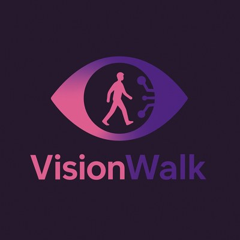
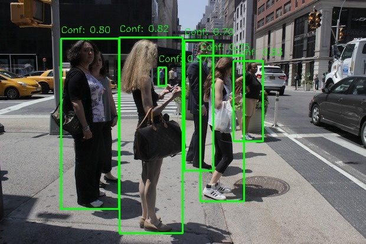
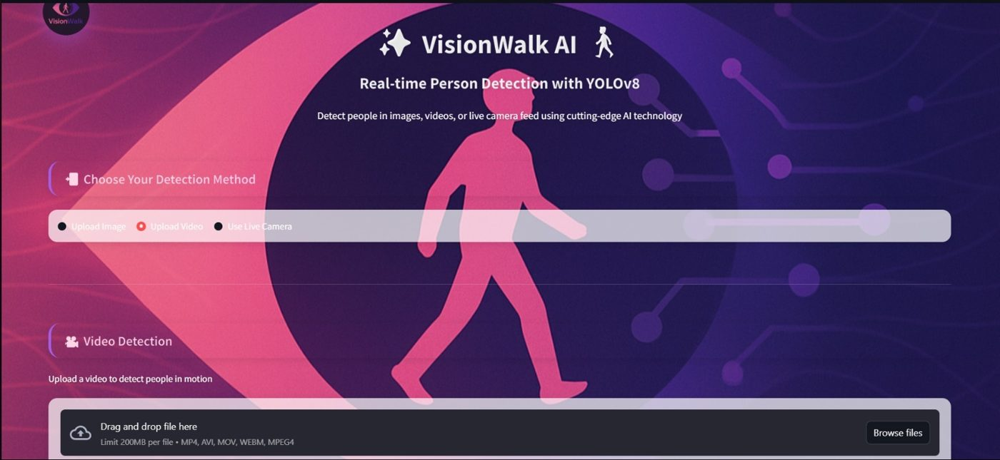
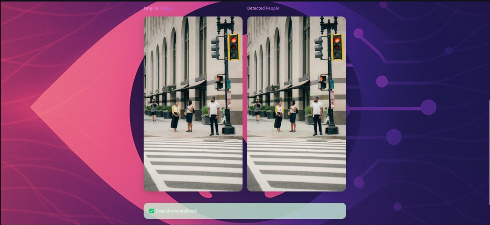
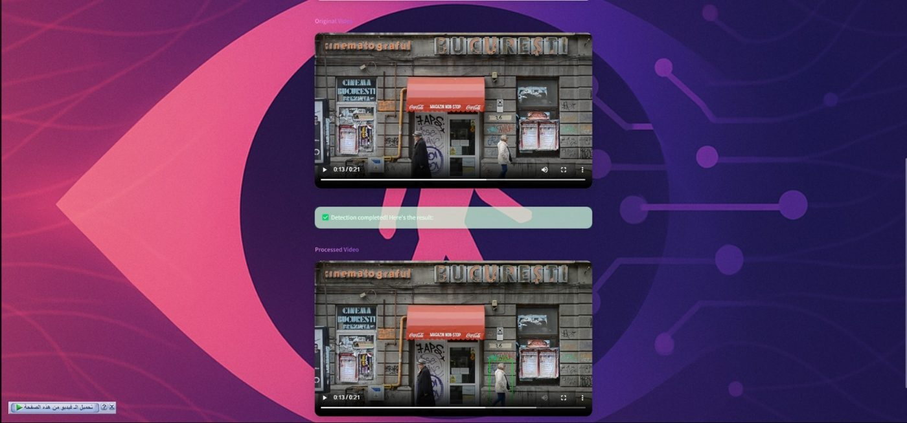

<p align="center">
  
</p>

<h1 align="center">VisionWalk</h1>

<p align="center">
  Real-time pedestrian detection with YOLOv8, on images, videos and a live camera.
</p>

<p align="center">
  
  
  
  
  
</p>

<p align="center">
  
</p>

## Overview

VisionWalk finds people in street scenes and draws a bounding box around each one. It is built for traffic safety, smart-city monitoring and crowd analysis. A YOLOv8s model fine-tuned on the Caltech Pedestrian dataset reaches **~80% detection accuracy**, and a Streamlit web app lets anyone try it on an image, a video or their own camera.

## Features

- **Image detection:** upload a photo and get every person boxed with a confidence score
- **Video detection:** process a whole clip frame by frame and play back the annotated result
- **Live camera:** real-time detection in the browser through WebRTC
- **Person-only output:** results are filtered to the person class, so cars and signs are ignored

## How it works

1. **Data.** The Caltech Pedestrian dataset is downloaded with `kagglehub`. Its `.seq` videos are split into frames, and the annotations are converted to YOLO format.
2. **Filtering.** Frames are sampled per video set into train and validation splits, keeping only frames that contain people.
3. **Augmentation.** Albumentations adds horizontal flips, brightness and contrast changes, small shift, scale and rotation, and Gaussian blur.
4. **Training.** YOLOv8s is fine-tuned for 10 epochs with batch size 64 on a Kaggle GPU, which produces `best.pt`.
5. **Inference.** The app runs the fine-tuned model on videos and the COCO-pretrained YOLOv8n on images and the live camera, keeping detections above a confidence of 0.5 (0.4 for live).

The full pipeline is in [`notebooks/training.ipynb`](notebooks/training.ipynb).

## Screenshots

| App | Image detection | Video detection |
|---|---|---|
|  |  |  |

## Run it locally

```bash
git clone https://github.com/Hagar202/VisionWalk.git
cd VisionWalk
pip install -r requirements.txt
```

Download `best.pt` from the [latest release](https://github.com/Hagar202/VisionWalk/releases/latest) into `weights/` (optional, see [`weights/README.md`](weights/README.md)), then start the app:

```bash
streamlit run app.py
```

It opens at `http://localhost:8501`.

## Project structure

```
VisionWalk/
├── app.py                  Streamlit interface
├── yolov8_inference.py     Image, video and live-camera detection
├── notebooks/
│   └── training.ipynb      Dataset processing, augmentation and training
├── weights/                yolov8n.pt included, best.pt from Releases
├── docs/                   Screenshots for this README
└── requirements.txt
```

## Tech stack

Python, Ultralytics YOLOv8, OpenCV, Albumentations, Pandas, Streamlit, streamlit-webrtc

## Team

Built by Team **EdgeVision** as a training project in the Shabab Mobtakeron AI program (Ministry of Youth and Sports, Egypt).

**Hagar Soliman** · [Portfolio](https://hagar202.github.io/portfolio/) · [LinkedIn](https://linkedin.com/in/hagar-soliman-0a6b41264)
